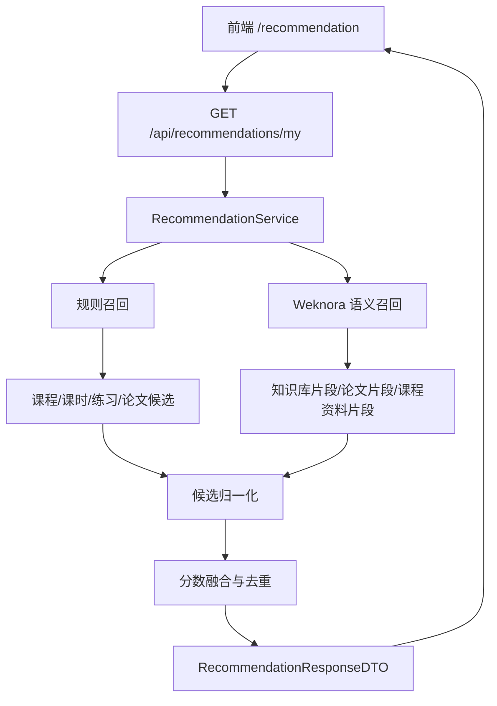

# Weknora 融合推荐实现计划

## 1. 当前推荐算法位置

当前推荐算法不在前端实现。

前端页面 `ai-learning-frontend/src/views/student/IntelligentRecommendation.vue` 只负责：

- 调用 `GET /api/recommendations/my`
- 传递筛选类型 `all/course/lesson/exercise/paper`
- 接收后端返回的 `items/counts/summary/profileTags`
- 按 `type` 分组展示卡片
- 显示后端返回的 `score/reason/meta`
- 点击卡片按钮跳转到 `targetUrl`

后端 `ai-learning-backend/src/main/java/com/cupk/aiacademy/service/RecommendationService.java` 负责真正的推荐逻辑：

- 学生画像：课程、班级、学习进度、成绩记录
- 召回：课程、未完成课时、题库练习、本地论文
- 打分：热度、难度、弱项课程、学习进度、论文引用量和年份
- 排序：按 `RecommendationItemDTO.score` 倒序
- 截断：按 `limit` 返回

因此 Weknora 融合推荐应该主要改后端，前端只需要展示新增的语义推荐理由、来源片段或资料来源。

## 2. 目标

在保留第一阶段规则推荐稳定性的基础上，引入 Weknora 作为语义召回层：

- 规则推荐继续负责确定性、可解释的学习路径推荐。
- Weknora 负责从课程资料、知识库文档、论文资料中做语义检索。
- 最终推荐结果融合规则分和语义分。
- 前端展示“为什么推荐”和“命中的知识来源”。

## 3. 前置条件

本地需要先完成 Weknora 配置：

- Docker Desktop 已安装并启动。
- Weknora API 运行在 `http://localhost:8090`。
- Weknora UI 运行在 `http://localhost:8091`。
- Weknora 已配置可用 LLM 和 Embedding 模型。
- 本项目后端已设置：
  - `WEKNORA_BASE_URL=http://localhost:8090`
  - `WEKNORA_API_KEY=<Weknora UI 中生成的 API Key>`
- 已创建至少一个课程/论文资料知识库，并上传可检索资料。

当前项目已提供本地配置脚本：

- `scripts/weknora-local/start-weknora.ps1`
- `scripts/weknora-local/configure-ai-learning-weknora.ps1`
- `scripts/weknora-local/verify-weknora.ps1`
- `scripts/weknora-local/builtin_models.yaml`
- `scripts/weknora-local/weknora.env.example`

## 4. 推荐融合架构



## 5. 数据流设计

### 5.1 用户画像构建

沿用第一阶段已有画像：

- 学生已加入课程
- 学生所属班级
- 学习进度
- 成绩记录
- 弱项课程
- 弱项知识点关键词
- 课程分类

新增语义查询词生成：

- 弱项课程名
- 低分考试/作业名称
- 题目知识点
- 已学课程分类
- 最近未完成课时标题

示例 query：

```text
数据结构 二叉树 遍历 易错点 练习 讲解
机器学习 过拟合 正则化 课程资料
计算机网络 TCP 拥塞控制 论文 拓展阅读
```

### 5.2 Weknora 召回

调用现有后端封装：

```java
weKnoraService.search(new WeKnoraSearchRequest(
    knowledgeBaseIds,
    query,
    limit,
    minScore
));
```

推荐服务不直接拼 HTTP 请求，统一复用：

- `com.cupk.aiacademy.weknora.service.WeKnoraService`
- `com.cupk.aiacademy.weknora.dto.WeKnoraSearchRequest`

### 5.3 知识库 ID 来源

优先顺序：

1. 课程表或课程扩展字段中保存 `knowledgeBaseId`。
2. Agent 定义中的 `knowledgeBaseIds`。
3. 系统配置项中保存默认推荐知识库 ID。
4. 没有知识库 ID 时跳过 Weknora 召回，回退到纯规则推荐。

建议新增配置：

```yaml
recommendation:
  weknora:
    enabled: ${RECOMMENDATION_WEKNORA_ENABLED:false}
    default-knowledge-base-ids: ${RECOMMENDATION_WEKNORA_KB_IDS:}
    semantic-weight: ${RECOMMENDATION_WEKNORA_SEMANTIC_WEIGHT:0.35}
    min-score: ${RECOMMENDATION_WEKNORA_MIN_SCORE:0.35}
    limit-per-query: ${RECOMMENDATION_WEKNORA_LIMIT_PER_QUERY:5}
```

## 6. 分数融合策略

第一版使用简单、可解释的线性融合：

```text
finalScore = ruleScore * 0.65 + semanticScore * 0.35 + sourceBoost
```

其中：

- `ruleScore`：第一阶段已有规则分，范围约 0-100。
- `semanticScore`：Weknora 返回分数归一化到 0-100。
- `sourceBoost`：来源补偿分。

建议来源补偿：

| 来源 | 加分 |
| --- | ---: |
| 命中当前课程知识库 | +8 |
| 命中弱项课程知识库 | +10 |
| 命中论文资料库 | +5 |
| 命中多个片段 | +3 |

如果 Weknora 没有返回有效结果：

```text
finalScore = ruleScore
```

这样可以保证 Weknora 不可用时推荐功能不降级为失败。

## 7. 后端实现步骤

### Step 1：新增配置类

新增：

- `RecommendationWeKnoraProperties`

职责：

- 是否启用 Weknora 推荐
- 默认知识库 ID
- 语义分权重
- 最小召回分
- 单 query 召回数量

### Step 2：扩展 DTO

扩展 `RecommendationItemDTO.meta`，不破坏现有接口：

```json
{
  "semanticScore": 82.4,
  "ruleScore": 76.0,
  "knowledgeBaseId": "kb-course-data-structure",
  "knowledgeId": "doc-123",
  "sourceTitle": "二叉树遍历课程讲义",
  "sourceSnippet": "先序遍历的访问顺序是根、左、右..."
}
```

不建议第一版新增复杂 DTO 字段，先放在 `meta` 里，前端兼容成本最低。

### Step 3：新增语义召回服务

新增服务：

- `RecommendationSemanticRecallService`

职责：

- 从学生画像生成 query
- 调用 `WeKnoraService.search`
- 解析并归一化 Weknora 返回结果
- 输出统一候选对象

建议内部对象：

```java
record SemanticRecallHit(
    String knowledgeBaseId,
    String knowledgeId,
    String title,
    String snippet,
    String sourceType,
    double semanticScore
) {}
```

### Step 4：融合到 RecommendationService

在 `recommendForStudent` 中：

1. 先生成规则推荐结果。
2. 判断 `recommendation.weknora.enabled`。
3. 如果启用且有知识库 ID，执行语义召回。
4. 将语义命中匹配到现有推荐项：
   - 课程推荐：按课程标题、分类、知识库 ID 匹配
   - 课时推荐：按课时标题、课程标题匹配
   - 练习推荐：按知识点匹配
   - 论文推荐：按论文标题、摘要关键词匹配
5. 更新 `score/reason/meta`。
6. 对没有规则候选但语义命中强的资料，生成 `paper` 或 `material` 类型推荐。

第一版可以不新增 `material` 类型，优先复用 `paper` 类型，减少前端改动。

### Step 5：失败降级

Weknora 调用失败时不能影响推荐页：

- 捕获异常。
- 打日志。
- 返回纯规则推荐。
- 在 `meta` 或 summary 中不暴露后端错误。

建议日志：

```text
Weknora semantic recall skipped: baseUrl={}, kbIds={}, reason={}
```

## 8. 前端实现步骤

前端不实现算法，只做展示增强。

### Step 1：展示语义来源

在推荐卡片中，如果存在：

- `item.meta.sourceTitle`
- `item.meta.sourceSnippet`
- `item.meta.semanticScore`

则展示一个轻量来源区：

```text
资料命中：二叉树遍历课程讲义
片段：先序遍历的访问顺序是根、左、右...
```

### Step 2：保留当前筛选逻辑

现有类型筛选继续由接口参数控制：

- `all`
- `course`
- `lesson`
- `exercise`
- `paper`

不在前端重新打分或排序。

### Step 3：交互跳转

Weknora 命中的资料可以跳转到：

- 知识库详情页
- 论文搜索页
- AI 对话页，携带 prompt 和资料上下文

第一版建议保守处理：

- 课程/课时仍跳原业务页。
- 论文/资料跳 `/paper-search` 或知识库页。
- 练习仍跳 `/agent-chat?prompt=...`。

## 9. 推荐接口保持兼容

接口仍然使用：

```http
GET /api/recommendations/my?type=all&limit=24
```

响应结构保持：

```json
{
  "summary": "...",
  "profileTags": ["..."],
  "items": [
    {
      "id": "course-1",
      "type": "course",
      "title": "...",
      "reason": "...",
      "score": 88.2,
      "targetUrl": "/courses/1",
      "meta": {
        "ruleScore": 78.0,
        "semanticScore": 91.0,
        "sourceTitle": "...",
        "sourceSnippet": "..."
      }
    }
  ],
  "counts": {
    "course": 4,
    "lesson": 6,
    "exercise": 8,
    "paper": 6
  }
}
```

## 10. 实施顺序

### 阶段 A：本地 Weknora 跑通

- 安装 Docker Desktop。
- 运行 `scripts/weknora-local/start-weknora.ps1`。
- 配置 LLM 和 Embedding API Key。
- 注册/登录 Weknora UI。
- 创建 API Key。
- 执行 `configure-ai-learning-weknora.ps1`。
- 重启 `ai-learning-backend`。
- 执行 `verify-weknora.ps1`。

验收标准：

- `http://localhost:8090/health` 正常。
- 本项目 `/api/weknora/knowledge-bases` 能返回结果。
- Weknora UI 可以创建知识库并上传资料。

### 阶段 B：资料导入

- 建立课程资料知识库。
- 上传课程讲义、论文、Markdown 笔记、PDF。
- 记录知识库 ID。
- 将知识库 ID 配置到推荐模块。

验收标准：

- `/api/weknora/search` 能检索到上传资料。
- 返回结果包含可读标题、片段、分数。

### 阶段 C：后端语义召回

- 新增推荐 Weknora 配置。
- 新增 `RecommendationSemanticRecallService`。
- 接入 `WeKnoraService.search`。
- 完成语义分归一化。
- 完成失败降级。

验收标准：

- Weknora 开启时，推荐项 `meta` 带 `semanticScore/sourceSnippet`。
- Weknora 关闭或不可用时，推荐接口仍返回第一阶段规则推荐。

### 阶段 D：分数融合

- 保存 `ruleScore`。
- 保存 `semanticScore`。
- 计算 `finalScore`。
- 按 `finalScore` 排序。
- 更新推荐理由。

验收标准：

- 弱项课程相关资料能排在更靠前位置。
- 推荐理由能说明“规则原因 + 资料命中原因”。

### 阶段 E：前端展示增强

- 展示命中来源标题。
- 展示命中片段。
- 展示语义分或来源标签。
- 保持原有类型筛选和跳转。

验收标准：

- 没有 Weknora 命中时 UI 不出现空白块。
- 有 Weknora 命中时能看到来源信息。
- 移动端卡片不溢出。

## 11. 风险和处理

| 风险 | 处理 |
| --- | --- |
| Docker 未安装 | 先只提交配置脚本，等 Docker 可用后启动 |
| Embedding Key 缺失 | 允许 Weknora 启动，但导入/检索前提示配置 |
| Weknora API Key 未设置 | 本项目后端保留纯规则推荐 |
| 召回结果结构变化 | 在语义召回服务中集中做兼容解析 |
| 语义召回过慢 | 限制 query 数量和每 query limit，后续加缓存 |
| 分数不可解释 | 保留 `ruleScore/semanticScore/sourceTitle/sourceSnippet` |

## 12. 第一版建议边界

第一版只做“规则推荐 + Weknora 资料增强”，不做复杂机器学习模型：

- 不新增用户行为埋点模型。
- 不训练排序模型。
- 不在前端打分。
- 不强制依赖 Weknora。
- 不改变现有推荐接口路径。

这样可以最大限度复用当前第一阶段成果，并保证 Weknora 本地配置不稳定时，推荐页仍然可用。
